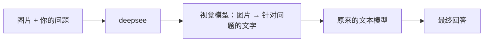

# deepsee

**让 DeepSeek 等纯文本模型读懂图片的本地视觉桥。**

deepsee 会先用你选择的视觉模型把图片转换成与问题相关的文字，再交给原来的文本模型回答。它可以作为命令行工具、Web 聊天界面、MCP Server，或 OpenAI / Anthropic 兼容代理使用。

[](https://www.python.org/)
[](https://github.com/rikfish163-rgb/deepsee/actions/workflows/ci.yml)
[](LICENSE)
[](pyproject.toml)

> [!IMPORTANT]
> 当前版本从 GitHub 安装。项目采用 `deepsee-mcp` 作为分发名，但尚未上传 PyPI；请不要运行 `pip install deepsee`，那是另一个项目。

快速导航：[开始使用](#3-分钟开始使用) · [选择接入方式](#选择最适合你的接入方式) · [常用场景](#常用场景) · [配置](#配置) · [常见问题](#常见问题) · [开发与贡献](#开发与贡献)

## 为什么需要 deepsee？

纯文本模型不能直接理解图片。即使聊天客户端允许粘贴图片，上游接口仍可能拒绝请求，或模型只能看到一个无意义的图片占位符。

deepsee 在本机增加一层视觉转换：



它不会把文本模型变成原生多模态模型，而是在请求到达文本模型之前，补上它缺少的视觉信息。

## 你可以用它做什么？

- 在 Claude Code、Codex、Cursor、Cline、Cherry Studio、ChatBox 等客户端中处理截图和图片。
- 从终端识图、提取文字，或比较 2–4 张图片。
- 在本地 Web 界面中粘贴图片并继续对话。
- 为 OpenAI 或 Anthropic 兼容客户端提供一个统一的本地代理。
- 通过 MCP 暴露识图、OCR、图片对比和状态检查工具。
- 连接任意 OpenAI 兼容视觉端点，并配置多供应商自动降级。

核心运行时只使用 Python 标准库。Pillow、RapidOCR 和官方 MCP SDK 都是按需安装的可选依赖。

## 3 分钟开始使用

### 1. 安装

需要 Python 3.9 或更高版本。推荐使用 [pipx](https://pipx.pypa.io/)，避免污染系统 Python：

```bash
pipx install 'git+https://github.com/rikfish163-rgb/deepsee.git'
deepsee --version
```

如果终端找不到 `deepsee`，运行 `pipx ensurepath`，然后重新打开终端。

准备使用离线 OCR 时，把安装命令换成：

```bash
pipx install 'deepsee-mcp[ocr] @ git+https://github.com/rikfish163-rgb/deepsee.git'
```

没有 pipx 时，使用独立虚拟环境：

```bash
python -m venv .venv
source .venv/bin/activate          # Windows: .venv\Scripts\activate
python -m pip install 'git+https://github.com/rikfish163-rgb/deepsee.git'
```

### 2. 完成向导

```bash
deepsee setup
```

向导只做三件事：

1. 选择视觉后端，用于把图片转换成文字。
2. 配置上游文本模型；只使用 CLI 或 MCP 时可以暂时留空。
3. 按检测结果安装 Claude Code Hook、Codex Skill 和 MCP 集成。

输入 API key 时终端不会回显。最终确认前，向导不会修改任何文件。

没有视觉 API key 时，可以选择：

- `demo`：验证安装和数据流，不会真正识别图片。
- `local-ocr`：离线提取图片文字，需要安装 `ocr` 可选依赖。
- `ollama`：通过本机 Ollama 的 `gemma3` 做完整识图，需先执行 `ollama pull gemma3`。

### 3. 立即试一次

用终端针对图片提问：

```bash
deepsee see ./screenshot.png -q "这个报错的根本原因是什么？"
```

或者打开本地聊天界面：

```bash
deepsee ui
```

`deepsee ui` 会启动代理和 Web 面板，并打开 `http://127.0.0.1:8090`。Web 对话需要在向导中配置上游文本模型。

最后运行诊断：

```bash
deepsee doctor
deepsee doctor --verify   # 联网视觉自检；可能读取最近图片或当前截图
```

看到视觉链配置正常后，就可以开始接入常用客户端。

## 选择最适合你的接入方式

| 目标 | 推荐方式 | 需要视觉后端 | 需要上游文本模型 |
|---|---|:---:|:---:|
| 在终端看图、OCR、对比图片 | CLI | 是 | 否 |
| 让模型主动调用识图工具 | MCP | 是 | 否 |
| 在浏览器中粘贴图片并聊天 | Web | 是 | 是 |
| 让任意聊天客户端透明处理图片 | 双协议代理 | 是 | 是 |
| Claude Code 读取图片文件 | Hook | 是 | 否 |
| Claude Code 覆盖粘贴图和 headless 场景 | 路由代理 | 是 | 是 |

如果不确定，从 `deepsee setup` → `deepsee see` 开始；确认识图正常后，再配置 Web 或代理。

## 常用场景

### 命令行识图

```bash
# 描述图片
deepsee see ./photo.jpg

# 围绕具体问题分析；提示会连同图片一起发给视觉模型
deepsee see ./chart.png -q "趋势拐点在哪里？依据是什么？"

# 明确任务类型：general / error / diagram / chart / ui / screenshot
deepsee see ./error.png --task error -q "给出最可能的修复步骤"

# 提取图片文字
deepsee ocr ./receipt.png

# 比较 2–4 张图片
deepsee compare before.png after.png -q "界面有哪些变化？"

# 把结果保存到文件
deepsee see ./diagram.png -o result.md
```

图片参数支持本地路径、HTTP(S) URL 和 data URI。

### Claude Code

`deepsee setup` 会询问是否安装 Hook 和 MCP。已有配置也可以单独安装：

```bash
deepsee install --hook
deepsee install --mcp
```

两种方案的覆盖范围不同：

- **Hook**：适合 Claude Code 在交互会话中通过 `Read` 读取图片文件。
- **MCP**：让模型调用 `analyze_image`、`ocr_image` 或 `compare_images`。
- **路由代理**：覆盖消息内粘贴的图片、headless 调用和其他图片块。

需要完整覆盖时：

```bash
deepsee route on
# 重启 Claude Code 后生效
```

该命令会启动本地代理，并把 Claude Code 的 `ANTHROPIC_BASE_URL` 写入 `~/.claude/settings.local.json`。此模式依赖 deepsee 中配置的上游文本模型和可用额度。

恢复原路由：

```bash
deepsee route off
```

### Codex

安装 Codex Skill：

```bash
deepsee install --skill
```

也可以把 Codex 使用的 OpenAI 兼容 provider 指向 deepsee 代理：

```text
Base URL: http://127.0.0.1:8081/v1
Model:    你在 deepsee 中配置的上游模型名
API key: 代理 master key；仅本机且未设置 master key 时可留空
```

### Cursor、Cline 和其他 MCP 客户端

GitHub 安装完成后，MCP Server 的启动命令是：

```bash
deepsee mcp
```

通用 MCP 配置：

```json
{
  "mcpServers": {
    "deepsee": {
      "command": "deepsee",
      "args": ["mcp"]
    }
  }
}
```

主要工具：

| 工具 | 用途 |
|---|---|
| `analyze_image` | 根据问题分析单张图片，可指定报错、图表、UI 等任务 |
| `ocr_image` | 提取图片中的文字 |
| `compare_images` | 比较 2–4 张图片 |
| `vision_status` | 查看视觉链状态与缓存提示 |
| `describe_image` | 兼容旧客户端的识图工具名 |

仓库根目录的 [`mcp.json`](mcp.json) 可作为配置模板。

### Cherry Studio、ChatBox、OpenCode 等 OpenAI 兼容客户端

先启动代理：

```bash
deepsee start
```

然后在客户端中填写：

```text
Base URL: http://127.0.0.1:8081/v1
Model:    你在 deepsee 中配置的上游模型名
API key: 代理 master key；仅本机且未设置 master key 时可留空
```

不想手动找字段时，直接打印当前配置：

```bash
deepsee client-cfg
```

代理同时接受 OpenAI 和 Anthropic 风格的请求，并会在转发前将图片块替换为视觉描述。

## deepsee 如何处理一次请求？

1. 接收本地路径、URL、data URI，或 OpenAI / Anthropic 消息中的图片块。
2. 根据用户的问题自动选择报错、技术图、图表、UI、截图或通用提示。
3. 调用视觉后端；失败时进入下一供应商，并短暂冷却故障后端。
4. 将视觉结果注入原请求，再转发给上游文本模型。
5. 对相同图片和问题使用短期内存缓存，减少重复调用。

支持的消息格式包括 OpenAI Chat、OpenAI Responses `input_image`，以及 Anthropic base64 / URL 图片块。

## 配置

默认配置文件：

```text
~/.deepsee/config.json
```

查看脱敏后的当前配置：

```bash
deepsee config show
```

修改单个字段：

```bash
deepsee config set upstream.base_url https://api.deepseek.com/v1
deepsee config set upstream.model deepseek-chat
deepsee config set upstream.format auto
```

需要自定义端口、协议或文生图后端时，使用高级向导：

```bash
deepsee setup --advanced
```

完整的供应商预设、字段说明、环境变量和配置组合见 [`docs/CONFIGURATION.md`](docs/CONFIGURATION.md)。

### 容器和 CI

所有关键连接参数都可以通过环境变量传入，不必写配置文件：

```bash
export DEEPSEE_VISION_BASE_URL='http://127.0.0.1:11434/v1'
export DEEPSEE_VISION_MODEL='gemma3'
export DEEPSEE_UPSTREAM_BASE_URL='https://api.example.com/v1'
export DEEPSEE_UPSTREAM_MODEL='your-text-model'
export DEEPSEE_UPSTREAM_API_KEY='...'

deepsee start
```

常用变量：

| 环境变量 | 作用 |
|---|---|
| `DEEPSEE_VISION_BASE_URL` | 第一视觉后端地址 |
| `DEEPSEE_VISION_MODEL` | 第一视觉模型名 |
| `DEEPSEE_VISION_API_KEY` | 第一视觉后端密钥 |
| `DEEPSEE_UPSTREAM_BASE_URL` | 上游文本模型地址 |
| `DEEPSEE_UPSTREAM_ANTHROPIC_BASE_URL` | 单独的 Anthropic 上游地址 |
| `DEEPSEE_UPSTREAM_MODEL` | 上游文本模型名 |
| `DEEPSEE_UPSTREAM_API_KEY` | 上游文本模型密钥 |
| `DEEPSEE_UPSTREAM_FORMAT` | `openai`、`anthropic` 或 `auto` |
| `DEEPSEE_PROXY_MASTER_KEY` | deepsee 代理访问密钥 |
| `DEEPSEE_HOME` | 覆盖配置目录，默认 `~/.deepsee` |

环境变量只覆盖当前运行配置，不会在保存配置时写回磁盘。

## 安全默认值

- 代理和 Web 服务默认只监听 `127.0.0.1`。
- API key 通过向导输入时不会回显；在 POSIX 系统上，配置文件权限设为 `0600`。
- `deepsee config show` 和状态输出会隐藏密钥。
- 请求体默认限制为 25 MB。
- 如果代理监听局域网或公网地址，请先设置 `DEEPSEE_PROXY_MASTER_KEY`。
- 不要把 Web 配置面板直接暴露到公网，也不要提交 `~/.deepsee/config.json` 或完整诊断日志。

## 常见问题

### `deepsee` 命令不存在

```bash
pipx ensurepath
```

重新打开终端后再运行 `deepsee --version`。如果使用虚拟环境，确认环境已经激活。

### CLI 能识图，但 Web 对话失败

CLI 和 MCP 只需要视觉后端；Web 和代理还需要上游文本模型。重新运行 `deepsee setup`，或在 Web 配置页补齐 upstream 地址、模型和 key。

### 端口 8081 或 8090 已被占用

临时换端口：

```bash
deepsee start --port 8082
deepsee web --port 8091
```

长期修改请运行 `deepsee setup --advanced`。

### 如何查看状态和日志？

```bash
deepsee status
deepsee doctor
deepsee doctor --verify
```

后台服务日志位于 `~/.deepsee/proxy.log` 和 `~/.deepsee/web.log`。

### 如何停止服务或撤销集成？

```bash
deepsee stop proxy
deepsee stop web
deepsee uninstall
```

`uninstall` 会移除集成并尽量从安装时的备份恢复客户端配置，但会保留 `~/.deepsee/config.json`。

## 命令速查

| 命令 | 作用 |
|---|---|
| `deepsee setup` | 三步配置向导 |
| `deepsee setup --advanced` | 配置端口、协议和可选文生图 |
| `deepsee see IMAGE` | 描述或分析图片 |
| `deepsee ocr IMAGE` | 提取图片文字 |
| `deepsee compare A B` | 比较 2–4 张图片 |
| `deepsee ui` | 启动代理和 Web 面板并打开浏览器 |
| `deepsee start` | 启动 OpenAI / Anthropic 双协议代理 |
| `deepsee web` | 启动 Web 面板 |
| `deepsee install` | 安装 Hook、MCP、Codex Skill 等集成 |
| `deepsee route on\|off` | 启用或恢复 Claude Code 代理路由 |
| `deepsee client-cfg` | 打印其他客户端的接入参数 |
| `deepsee doctor --verify` | 检查配置并发送真实视觉请求 |
| `deepsee uninstall` | 停止服务并撤销集成 |

## 兼容性

- Python 3.9 或更高版本；CI 当前覆盖 3.9–3.12。
- Linux、macOS 和 Windows。
- OpenAI 兼容视觉后端，以及本地 Ollama `gemma3`。
- OpenAI / Anthropic 兼容上游和流式转发。
- 本地路径、URL、data URI、OpenAI 图片块和 Anthropic 图片块。
- 2–4 图对比、任务化提示、短期缓存、供应商降级与失败冷却。

CI 在 Ubuntu、macOS 和 Windows 上运行离线测试。真实供应商是否可用仍取决于端点、模型、额度和网络状态。

## 项目结构

```text
deepsee/
├── caption.py       识图、OCR、问答和多图对比
├── chat.py          Web 与代理共用的对话编排
├── cli.py           命令行入口
├── config.py        配置、供应商预设和环境变量
├── hook_claude.py   Claude Code PreToolUse Hook
├── installer.py     向导、集成安装、备份与回退
├── mcp_server.py    轻量 MCP Server
├── proxy.py         OpenAI / Anthropic 双协议代理
├── vision.py        视觉客户端、缓存和供应商降级链
└── web.py           Web 服务与静态界面

docs/                配置、架构和产品说明
tests/               全离线测试
```

## 开发与贡献

```bash
git clone https://github.com/rikfish163-rgb/deepsee.git
cd deepsee
python -m venv .venv
source .venv/bin/activate
python -m pip install -e '.[dev]'
pytest -q
```

测试使用隔离配置和 mock 服务，不读取真实 `~/.deepsee`，也不需要 API key。

- 版本变化：[`CHANGELOG.md`](CHANGELOG.md)
- 贡献说明：[`CONTRIBUTING.md`](CONTRIBUTING.md)
- 架构说明：[`docs/architecture.md`](docs/architecture.md)
- 安全报告：[`SECURITY.md`](SECURITY.md)

## License

[MIT License](LICENSE)

### Standalone Agent Skill

The existing skill is also available as [`deepsee/skill/`](deepsee/skill/), with
runtime prerequisites, safe usage and CLI/MCP examples. See
[distribution and client setup](docs/SKILL_DISTRIBUTION.md) for Claude Code,
Cursor, Copilot and isolated Codex installation. No marketplace account is needed.
